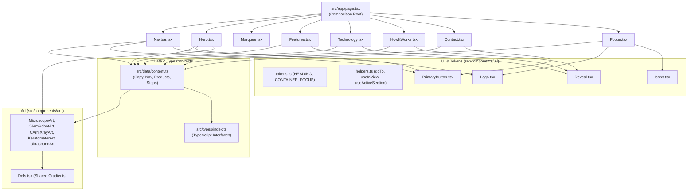

# MedWorks – Codebase Architecture & File Structure Guide

This document provides a comprehensive map of the MedWorks repository. It is designed to enable AI coding assistants and human developers to rapidly locate, modify, and extend files without redundant scanning.

---

## 1. Directory Tree & File Inventory

```
c:\Drive\MedWorks\
├── docs/
│   ├── brain.md                         # Project overview, value proposition & technical conventions
│   └── architecture.md                  # Complete architectural map & symbol index (this file)
├── public/
│   ├── file.svg                         # Static vector icons
│   ├── globe.svg
│   ├── next.svg
│   ├── vercel.svg
│   └── window.svg
├── src/
│   ├── app/
│   │   ├── favicon.ico                  # Application browser favicon
│   │   ├── globals.css                  # Tailwind CSS import, themes & marquee animations
│   │   ├── layout.tsx                   # Next.js root html/body shell with base fonts
│   │   └── page.tsx                     # Top-level composition page orchestrator
│   ├── components/
│   │   ├── art/                         # SVG medical device illustrations
│   │   │   ├── Defs.tsx                 # Shared linear gradients (metallic, screens, shades)
│   │   │   ├── CArmRobotArt.tsx         # Isometric C-arm robotic arm illustration
│   │   │   ├── CArmXrayArt.tsx          # C-arm surgical X-ray machine illustration
│   │   │   ├── KeratometerArt.tsx       # Refractor keratometer diagnostic unit illustration
│   │   │   ├── MicroscopeArt.tsx        # Gemology & lab inspection microscope illustration
│   │   │   ├── UltrasoundArt.tsx        # Mobile Doppler ultrasound workstation illustration
│   │   │   └── index.ts                 # Barrel exports for all art components
│   │   ├── sections/                    # Primary landing page sections
│   │   │   ├── Navbar.tsx               # Navigation bar, dropdowns & mobile drawer
│   │   │   ├── Hero.tsx                 # Hero fold, fluid headings & mini product previews
│   │   │   ├── Features.tsx             # Visual featured product showcases
│   │   │   ├── Technology.tsx           # Dark theme qualified technology grid
│   │   │   ├── HowItWorks.tsx           # Interactive 4-step accordion with floating art
│   │   │   ├── Contact.tsx              # Demo scheduling and inquiry form
│   │   │   ├── Footer.tsx               # Footer sitemap, newsletter & social links
│   │   │   └── index.ts                 # Barrel exports for all section components
│   │   └── ui/                          # Atomic UI elements, tokens, and hooks
│   │       ├── tokens.ts                # Typography classes, container constraints & focus rings
│   │       ├── helpers.ts               # Hooks: useInView, useActiveSection; utils: goTo, motion
│   │       ├── Icons.tsx                # Reusable SVGs: ArrowRight, Chevron, SocialIcon
│   │       ├── Logo.tsx                 # MedWorks branding logo with responsive toggle
│   │       ├── PrimaryButton.tsx        # Pill CTA button with responsive sizing props
│   │       ├── Reveal.tsx               # Intersection Observer-driven animated wrapper
│   │       └── Marquee.tsx              # Infinitely scrolling horizontal ticker
│   ├── data/
│   │   └── content.ts                   # Centralized copy, product lists, nav links & constants
│   └── types/
│       └── index.ts                     # TypeScript interfaces (NavLink, Product, Step, FormState)
├── .gitignore                           # Git ignore configuration
├── AGENTS.md                            # Next.js guidelines for autonomous agents
├── eslint.config.mjs                    # ESLint configuration
├── next.config.ts                       # Next.js compiler & build configuration
├── package.json                         # Dependencies, scripts & metadata
├── README.md                            # Standard project README
└── tsconfig.json                        # TypeScript compiler options & `@/*` alias mapping
```

---

## 2. Component Hierarchy & Data Flow



---

## 3. Module Index & Symbol Reference

### 3.1 Application Shell
- **[`src/app/page.tsx`](file:///c:/Drive/MedWorks/src/app/page.tsx)**
  - *Exports*: `default function Page()`
  - *Imports*: `Navbar`, `Hero`, `Marquee`, `Features`, `Technology`, `HowItWorks`, `Contact`, `Footer`, `useActiveSection`, `SECTION_IDS`, fonts (`Raleway`, `Inter`).
  - *Role*: Assembles all top-level sections into a single responsive view. Applies font variables.
- **[`src/app/layout.tsx`](file:///c:/Drive/MedWorks/src/app/layout.tsx)**
  - *Exports*: `metadata`, `default function RootLayout({ children })`
  - *Role*: Root HTML/body wrapper and global stylesheet loader.
- **[`src/app/globals.css`](file:///c:/Drive/MedWorks/src/app/globals.css)**
  - *Role*: Tailwind v4 theme directives, CSS variables (`--background`, `--foreground`), and keyframe animations for `.mw-marquee-track`.

---

### 3.2 Sections (`src/components/sections/`)
- **[`Navbar.tsx`](file:///c:/Drive/MedWorks/src/components/sections/Navbar.tsx)**
  - *Exports*: `Navbar({ activeId }: { activeId: string })`
  - *Internal*: `NavDropdown`
  - *Role*: Manages header scroll state, desktop navigation menu, and full-screen mobile drawer. Renders responsive `PrimaryButton` for demonstration scheduling.
- **[`Hero.tsx`](file:///c:/Drive/MedWorks/src/components/sections/Hero.tsx)**
  - *Exports*: `Hero()`
  - *Internal*: `ExploreText`, `ScrollDownButton`
  - *Role*: Displays the above-the-fold value proposition with fluid CSS clamp fonts, mini product preview cards, and the main hero microscope visual.
- **[`Features.tsx`](file:///c:/Drive/MedWorks/src/components/sections/Features.tsx)**
  - *Exports*: `Features()`
  - *Role*: 2-column feature highlight card grid using `FEATURES` data with frosted backdrop panels.
- **[`Technology.tsx`](file:///c:/Drive/MedWorks/src/components/sections/Technology.tsx)**
  - *Exports*: `Technology()`
  - *Role*: Dark-mode 3-card grid rendering products defined in `PRODUCTS`.
- **[`HowItWorks.tsx`](file:///c:/Drive/MedWorks/src/components/sections/HowItWorks.tsx)**
  - *Exports*: `HowItWorks()`
  - *Role*: Interactive step accordion. On hover/click, displays the active process description and reveals tilted 3D-styled artwork (`STEPS`).
- **[`Contact.tsx`](file:///c:/Drive/MedWorks/src/components/sections/Contact.tsx)**
  - *Exports*: `Contact()`
  - *Internal*: `Field`, `validate`
  - *Role*: Controlled booking and contact form with client-side regex validation. Manages appointment date with deferred minimum date initialization via `useEffect`.
- **[`Footer.tsx`](file:///c:/Drive/MedWorks/src/components/sections/Footer.tsx)**
  - *Exports*: `Footer()`
  - *Role*: Site directory links (`FOOTER_COLUMNS`), interactive newsletter subscription form, and social media handles.

---

### 3.3 UI Primitives & Design Tokens (`src/components/ui/`)
- **[`tokens.ts`](file:///c:/Drive/MedWorks/src/components/ui/tokens.ts)**
  - *Exports*: `HEADING`, `CONTAINER`, `FOCUS`
  - *Role*: Standardized Tailwind utility strings for consistent padding, fonts, and accessible focus states.
- **[`helpers.ts`](file:///c:/Drive/MedWorks/src/components/ui/helpers.ts)**
  - *Exports*: `prefersReducedMotion()`, `goTo(href)`, `useInView(threshold)`, `useActiveSection(ids)`
  - *Role*: Utility functions for smooth scrolling, reduced motion detection, and intersection observer tracking.
- **[`PrimaryButton.tsx`](file:///c:/Drive/MedWorks/src/components/ui/PrimaryButton.tsx)**
  - *Exports*: `PrimaryButton({ children, href, onClick, size, className, disabled, type })`
  - *Role*: Reusable interactive button or link styled as a royal blue pill. Supports `size="sm" | "md" | "lg"`.
- **[`Reveal.tsx`](file:///c:/Drive/MedWorks/src/components/ui/Reveal.tsx)**
  - *Exports*: `Reveal({ children, delay, className })`
  - *Role*: Wraps sections to provide upward translate and opacity fade-in once in viewport.
- **[`Marquee.tsx`](file:///c:/Drive/MedWorks/src/components/ui/Marquee.tsx)**
  - *Exports*: `Marquee({ text: string })`
  - *Role*: Seamless CSS ticker repeating given text with star separator glyphs.
- **[`Logo.tsx`](file:///c:/Drive/MedWorks/src/components/ui/Logo.tsx)**
  - *Exports*: `Logo({ dark?: boolean })`
  - *Role*: MedWorks graphic glyph and brand wordmark.
- **[`Icons.tsx`](file:///c:/Drive/MedWorks/src/components/ui/Icons.tsx)**
  - *Exports*: `ArrowRight`, `Chevron`, `SocialIcon`
  - *Role*: Pure SVG vectors for arrows, dropdown chevrons, and social buttons.

---

### 3.4 Illustrations (`src/components/art/`)
- **[`Defs.tsx`](file:///c:/Drive/MedWorks/src/components/art/Defs.tsx)**: Reusable SVG gradients (`#mw-white`, `#mw-dark`, `#mw-screen`).
- **[`MicroscopeArt.tsx`](file:///c:/Drive/MedWorks/src/components/art/MicroscopeArt.tsx)**: Laboratory and gemstone microscope illustration.
- **[`KeratometerArt.tsx`](file:///c:/Drive/MedWorks/src/components/art/KeratometerArt.tsx)**: Eye care refractometer workstation illustration.
- **[`UltrasoundArt.tsx`](file:///c:/Drive/MedWorks/src/components/art/UltrasoundArt.tsx)**: Doppler ultrasound cart with wheels and dual probes.
- **[`CArmRobotArt.tsx`](file:///c:/Drive/MedWorks/src/components/art/CArmRobotArt.tsx)**: Surgical robotic C-arm illustration with multi-joint indicators.
- **[`CArmXrayArt.tsx`](file:///c:/Drive/MedWorks/src/components/art/CArmXrayArt.tsx)**: Mobile C-arm fluoroscopy X-ray system illustration.

---

### 3.5 Data & Types
- **[`src/data/content.ts`](file:///c:/Drive/MedWorks/src/data/content.ts)**
  - *Exports*: `BRAND`, `YEAR`, `CONTACT`, `NAV`, `FEATURES`, `PRODUCTS`, `STEPS`, `TIME_SLOTS`, `FOOTER_COLUMNS`, `SECTION_IDS`
  - *Role*: Central data repository. Update this file to change text copy, add equipment, or adjust URLs.
- **[`src/types/index.ts`](file:///c:/Drive/MedWorks/src/types/index.ts)**
  - *Exports*: `NavLink`, `Product`, `Step`, `FooterColumn`, `FormState`, `FormErrors`
  - *Role*: TypeScript definitions governing data schemas.

---

## 4. AI Developer Task Routing (Where to Edit)

| If you need to... | Target File(s) |
| :--- | :--- |
| **Change marketing copy, product titles, or descriptions** | [`src/data/content.ts`](file:///c:/Drive/MedWorks/src/data/content.ts) |
| **Add or remove a link in the header or footer** | [`src/data/content.ts`](file:///c:/Drive/MedWorks/src/data/content.ts) (`NAV` or `FOOTER_COLUMNS`) |
| **Adjust button sizing, colors, or hover glow** | [`src/components/ui/PrimaryButton.tsx`](file:///c:/Drive/MedWorks/src/components/ui/PrimaryButton.tsx) or [`tokens.ts`](file:///c:/Drive/MedWorks/src/components/ui/tokens.ts) |
| **Update the contact form inputs or validation rules** | [`src/components/sections/Contact.tsx`](file:///c:/Drive/MedWorks/src/components/sections/Contact.tsx) |
| **Change marquee speed, text, or animation behavior** | [`src/app/globals.css`](file:///c:/Drive/MedWorks/src/app/globals.css) and [`src/components/ui/Marquee.tsx`](file:///c:/Drive/MedWorks/src/components/ui/Marquee.tsx) |
| **Swap an SVG illustration for real photography** | In [`src/data/content.ts`](file:///c:/Drive/MedWorks/src/data/content.ts), swap the `Art` component in `FEATURES` or `PRODUCTS` for a `next/image` component |
| **Reorder or add landing page sections** | [`src/app/page.tsx`](file:///c:/Drive/MedWorks/src/app/page.tsx) |
| **Add a new page route (e.g. `/about` or `/products`)** | Create `src/app/<route>/page.tsx` |
